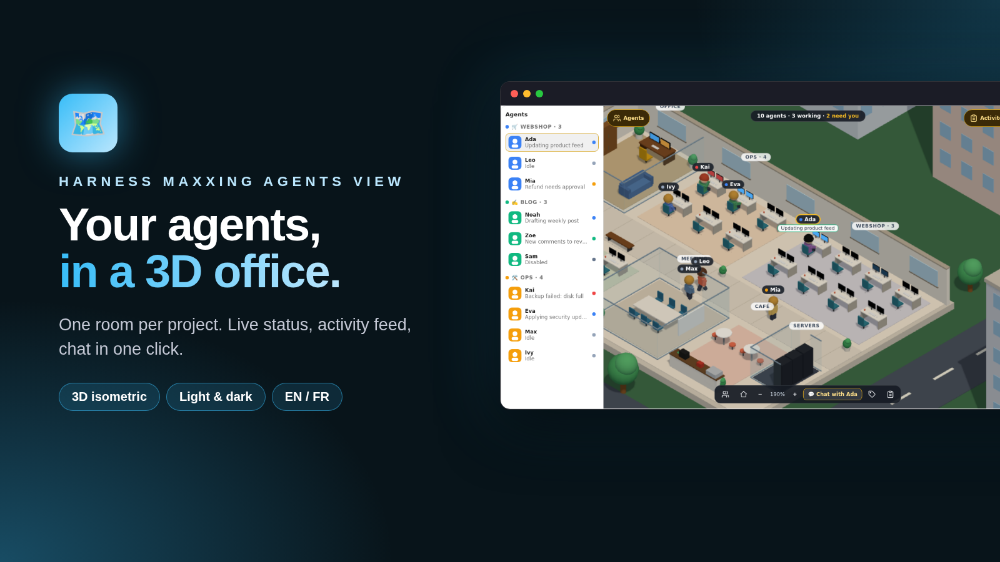
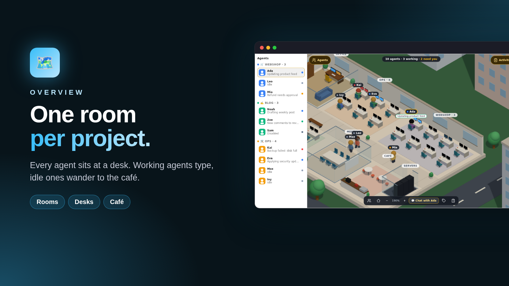
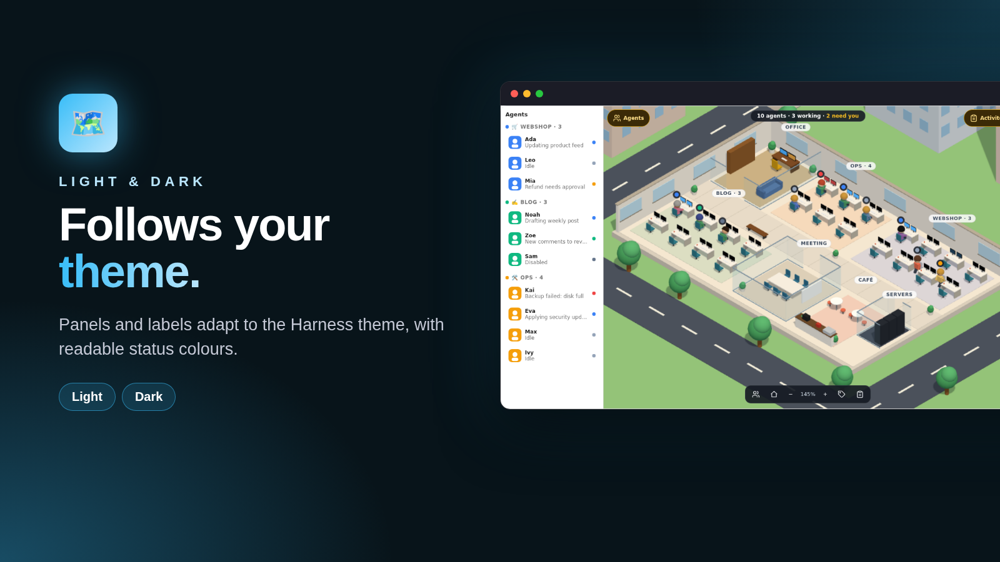
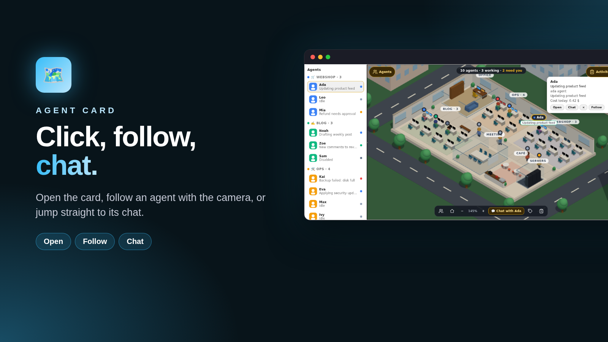
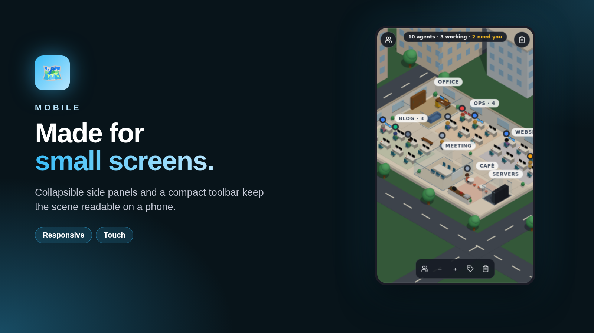

# Agents world — a 3D office view for Harness Maxxing



An **Agents view** extension for [Harness Maxxing](https://harness-maxxing.com): your agents
appear as small pixel-art characters in an isometric 3D office. One room per project, one desk
per agent. Working agents type at their desk, idle ones wander to the café, agents that need you
are highlighted. Plain Three.js, one self-contained HTML file, no network access, no server code.

| | |
|---|---|
|  |  |
|  |  |

(Screenshots use fictitious demo data.)

## Features

- One room per project (colour and name from the project), agents placed at the desks of their room.
- Live status from the standard Harness data (`running`, `waiting`, `unread`, `failed`, `off`, `idle`).
- Left list of agents grouped by project, right panel with counters and an activity feed
  (all / needs you).
- Click an agent: card with status, last run, cost of the day, **Open**, **Chat** (uses the agent's
  `chat_route`) and **Follow** (the camera follows the character).
- Bottom toolbar: zoom, reset, labels, panels; a **Chat with …** button for the selected agent.
- Light and dark themes (follows the host), English and French (follows the host language),
  mobile layout, `prefers-reduced-motion` respected, adaptive pixel ratio.
- Shows a plain message if WebGL is unavailable.

## Installation

1. Copy `manifest.json` and the built `agents-view.html` into `<workspace>/extensions/agents-view-world/`.
2. Settings -> Pages (or Widgets) -> Rescan. The view appears in the **Overview** of the Agents page
   (view selector).

Or ask a Harness session: *"Install the extension from this repository"*.

The repository already contains the built `agents-view.html`; rebuild it only if you edit the sources.

## Build from source

```sh
npm install
npm run build   # src/ -> agents-view.html (esbuild, Three.js r160 tree-shaken)
npm test        # Playwright: loads the view with fictitious data, fails on any console error
```

`npm test` needs Playwright (`npm i -D playwright`, or set `PW_DIR` to a folder that has it). `SHOTS=1 npm test` also writes raw screenshots to `docs/`.

Sources: `src/app.js` (scene, characters, pathfinding, panels), `src/styles.css`, `src/body.html`,
`src/main.js` (entry, WebGL check), `build.mjs`.

## How it works

The host passes `maxxing.data` (`projects[].agents[]` with `status`, `status_text`, `route`,
`chat_route`, `avatar_svg`, `cost_today`, `last_run`…). The view only calls
`maxxing.navigate(route | chat_route | new_agent_route)`, `maxxing.resize`, `maxxing.theme` and
`maxxing.onTheme`. It never talks to the network and reads nothing else.

## Limits

- The office has **3 project rooms and 22 desks**. With more projects, the extra ones share free
  desks and the room label shows `NAME +N`. Agents beyond 22 are not drawn (the list on the left
  still shows them, and a notice says how many).
- Software WebGL (no GPU) works but is slow.

## Credits and license

MIT, see `LICENSE`. Built with [Three.js](https://threejs.org) (MIT), embedded in the built file.

---

## Français

Vue « Agents » pour Harness Maxxing : vos agents dans un bureau 3D isométrique, une salle par
projet, un bureau par agent. Installation : copier `manifest.json` et `agents-view.html` dans
`<workspace>/extensions/agents-view-world/`, puis Réglages -> Pages -> Rescan. Le bouton de
discussion utilise le `chat_route` de l'agent. Limites : 3 salles et 22 bureaux ; au-delà, les
projets partagent les bureaux libres.
